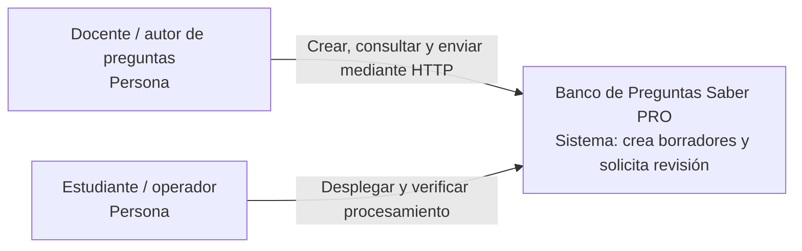
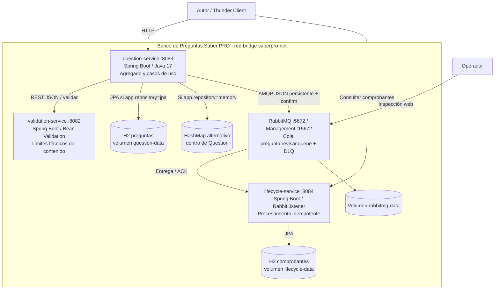
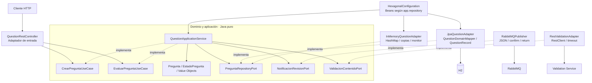
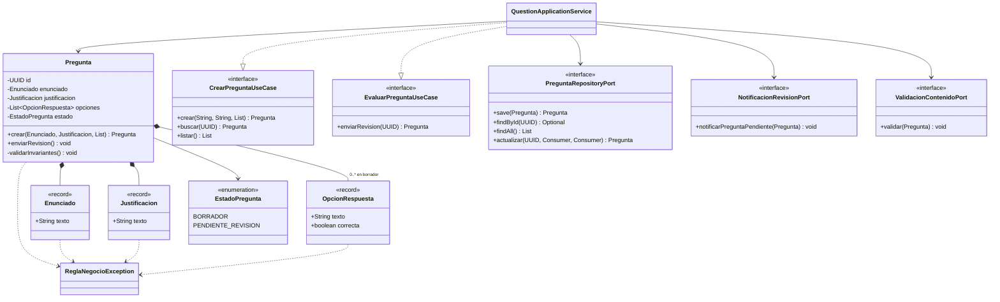
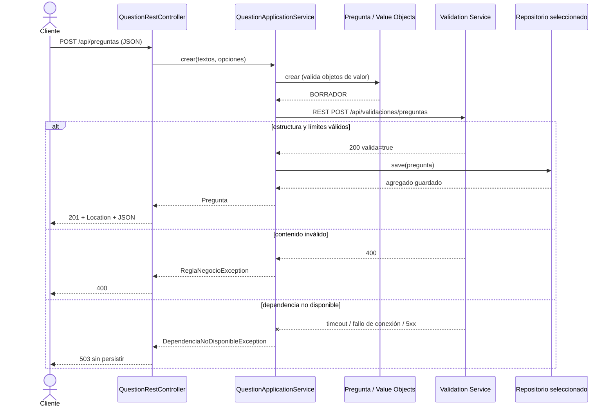
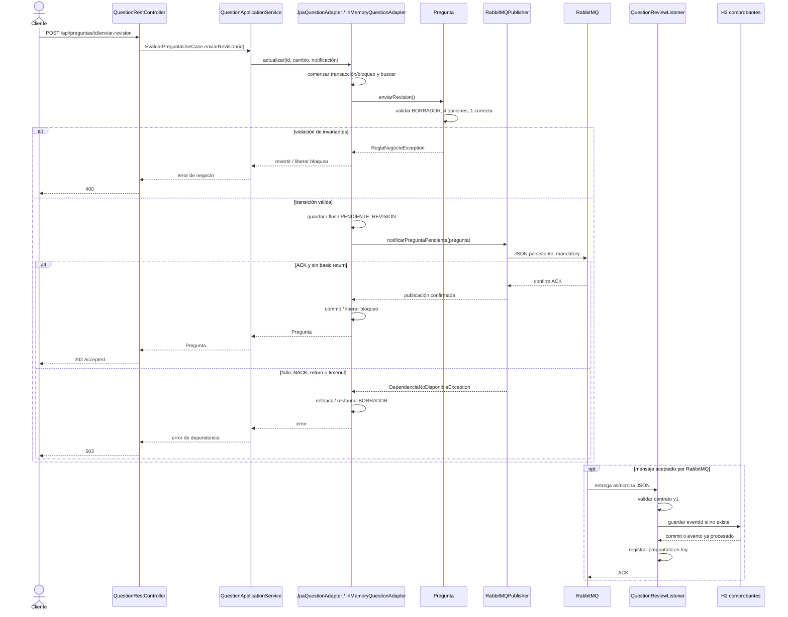

# Diagramas de la implementación — C4 y secuencia
# Diagramas de la implementación — C4 y secuencia

Los bloques Mermaid son fuentes editables para renderizar y exportar a SVG/PNG. Los nodos describen componentes que existen en el repositorio. El Nivel 4 se concentra en el agregado y los puertos de Question. Estos diagramas no son capturas de ejecución.

## C4 Nivel 1 — Contexto del sistema

No se representan autenticación, correos ni un evaluador humano automatizado porque no están implementados.

## C4 Nivel 2 — Contenedores

H2 es embebido en cada JVM, representado como almacenamiento, no como un contenedor Docker independiente. Hay cuatro contenedores Docker: tres aplicaciones y RabbitMQ.

## C4 Nivel 3 — Componentes de Question Service

Las flechas punteadas indican implementación de contratos; los adaptadores dependen de los puertos del núcleo.

## C4 Nivel 4 — Código del agregado y casos de uso

La multiplicidad permite borradores; el método de revisión exige exactamente cuatro opciones y una correcta. No se representa GoF State: el código utiliza un enum y un método del agregado.

## Secuencia REST síncrona de creación

## Secuencia de revisión y RabbitMQ

El consumidor puede procesar antes del commit o antes de la respuesta HTTP: el orden de entrega asíncrona no está sincronizado con la transacción de Question. La secuencia agrupa ese tramo para facilitar su lectura; ver las ventanas de fallo documentadas en `decisiones.md`.
