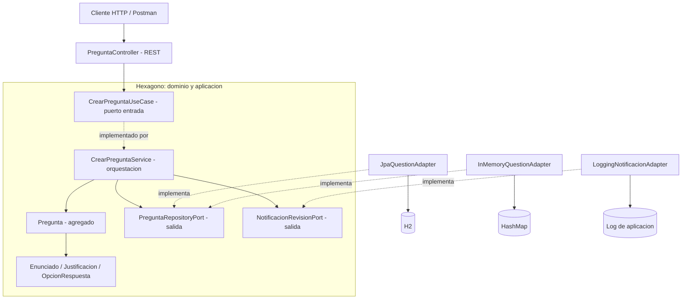
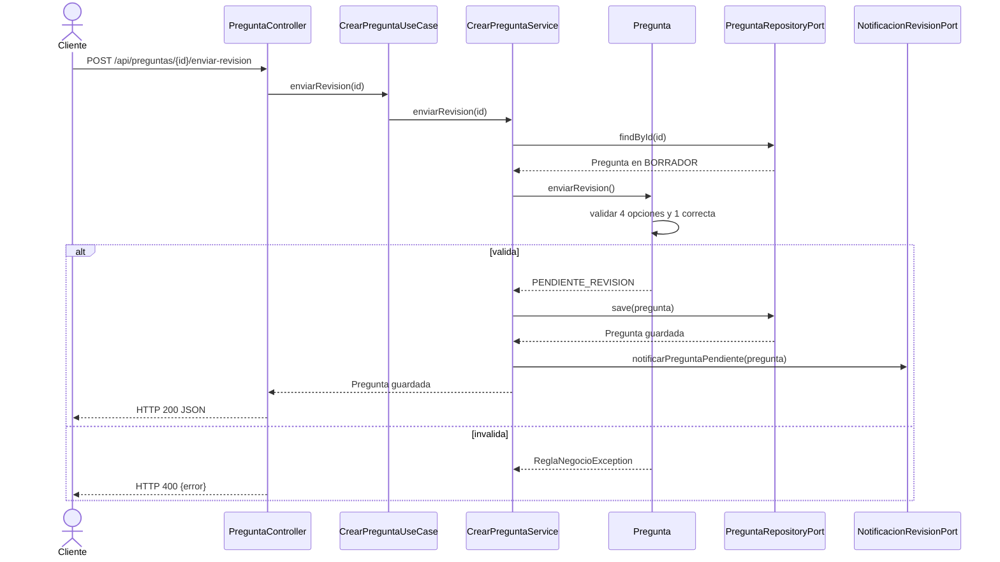
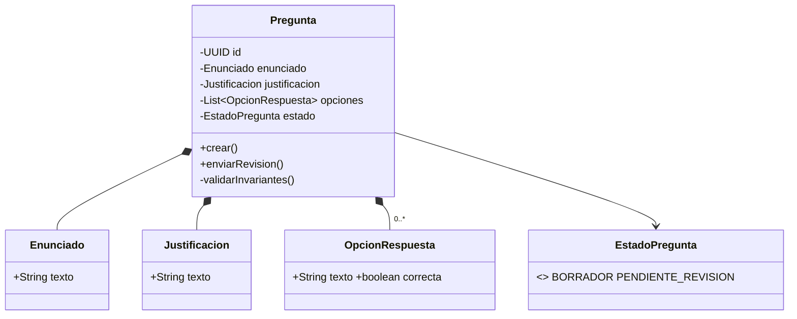

# Diagramas de arquitectura - Taller 12

## Arquitectura hexagonal

## Secuencia de enviar a revision

## Modelo de dominio

La multiplicidad `0..*` en BORRADOR es deliberada: la guia exige validar exactamente 4 al enviar a revision, no al crear el borrador.
